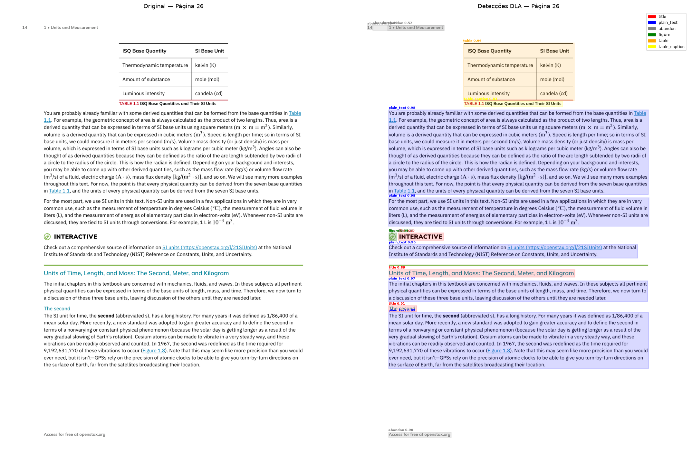
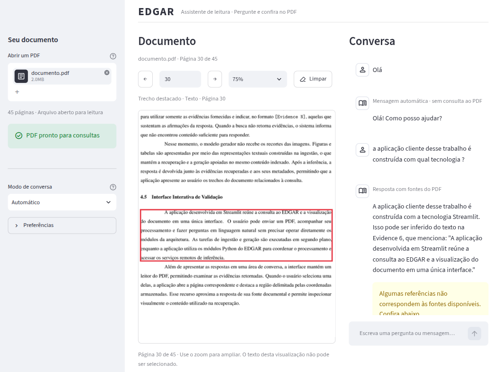

# EDGAR: Uma Arquitetura MRAG de Granularidade Fina Voltada para Documentos Didáticos em PDF

[](https://www.quixada.ufc.br/)
[](#)
[%202026-success?style=flat-square)](#)
[](documento.tex)
[](documento.pdf)

Repositório oficial da monografia de Trabalho de Conclusão de Curso (TCC) apresentada ao curso de **Bacharelado em Ciência da Computação** da **Universidade Federal do Ceará (UFC) — Campus de Quixadá**.

> 📄 **Acesso direto:** [Visualizar / baixar a monografia completa em PDF (`documento.pdf`)](documento.pdf)

---

## 📋 Informações Acadêmicas

| Campo | Detalhe |
| :--- | :--- |
| **Título** | EDGAR: Uma Arquitetura MRAG de Granularidade Fina Voltada para Documentos Didáticos em PDF |
| **Autor** | Francisco Edinaldo dos Santos Silva |
| **Orientador** | Prof. Dr. Cristiano Bacelar de Oliveira |
| **Instituição** | Universidade Federal do Ceará (UFC) — Campus de Quixadá |
| **Curso** | Bacharelado em Ciência da Computação |
| **Ano** | 2026 |

---

## 📖 Resumo

Este trabalho apresenta o **EDGAR**, uma arquitetura de **Geração Aumentada por Recuperação Multimodal (MRAG)** de granularidade fina, voltada à consulta de documentos didáticos em PDF. A arquitetura combina técnicas de análise de documentos, extração textual e descrição de elementos visuais para organizar e recuperar informações em nível de componentes.

Essa abordagem permite utilizar conteúdos textuais e visuais na construção do contexto das respostas, preservando a **rastreabilidade das evidências** no documento original por meio de coordenadas geométricas (*bounding boxes*). Para demonstrar seu funcionamento, foi implementada uma interface web interativa em Streamlit que permite consultar os materiais e visualizar as regiões recuperadas diretamente sobre as páginas do PDF.

**Palavras-chave:** geração aumentada por recuperação; recuperação multimodal; granularidade fina; processamento de documentos; rastreabilidade visual.

<details>
<summary><strong>🇬🇧 Abstract (English)</strong></summary>

This work presents **EDGAR**, a fine-grained **Multimodal Retrieval-Augmented Generation (MRAG)** architecture designed for querying educational documents in PDF format. The architecture combines document analysis, text extraction, and visual element description techniques to organize and retrieve information at the component level. This approach enables the use of textual and visual content to build the context for response generation while preserving the traceability of evidence to the original document. To demonstrate its functionality, an interactive web interface was implemented, allowing users to query documents and visualize the retrieved evidence. The architecture was subjected to a comparative experimental evaluation against traditional text-based RAG approaches, considering information retrieval and the quality of generated responses.

**Keywords:** retrieval-augmented generation; multimodal retrieval; fine-grained retrieval; document processing; visual traceability.

</details>

---

## 🧠 Visão Geral da Arquitetura

O EDGAR opera sem treinamento adicional ou ajuste fino (*training-free*), dividindo o processamento em dois fluxos complementares:

1. **Fluxo de Ingestão e Indexação (*offline*):** converte as páginas do PDF em imagens, identifica regiões estruturais (parágrafos, títulos, tabelas, figuras e legendas) com análise de *layout*, extrai texto nativo ou aplica OCR localizado, reconstrói tabelas quando possível e gera descrições textuais para figuras e tabelas sem texto recuperável via modelo de visão e linguagem (VLM). Cada componente é vetorizado e armazenado com metadados e coordenadas geométricas.
2. **Fluxo de Recuperação e Geração (*online*):** vetoriza a pergunta do usuário, recupera os componentes mais similares no banco vetorial, monta o contexto respeitando o orçamento de entrada e gera uma resposta fundamentada com citações explícitas às evidências (`[Evidence N]`), permitindo inspecionar a região exata no PDF pela interface web.

### Componentes Tecnológicos

| Módulo | Tecnologia | Função |
| :--- | :--- | :--- |
| Preparação de PDFs | **PyMuPDF** | Renderização de páginas, extração textual e dados de posicionamento |
| Análise de *layout* | **DocLayout-YOLO** | Detecção de componentes estruturais e coordenadas (*bounding boxes*) |
| Recortes visuais | **Pillow (PIL)** | Isolamento das imagens dos componentes detectados |
| Reconhecimento textual | **Tesseract OCR** | Extração alternativa para regiões sem texto digital acessível |
| Descrição visual | **Qwen3-VL-4B-Instruct** | Descrição textual de figuras e tabelas sem estrutura textual recuperável |
| Representação vetorial | **BGE-M3** | Geração de *embeddings* densos de 1.024 dimensões |
| Armazenamento e busca | **Qdrant** | Indexação vetorial, metadados e busca por similaridade de cosseno |
| Geração de respostas | **Qwen2.5-7B-Instruct** | Geração de respostas ancoradas nas evidências recuperadas |
| Interface de validação | **Streamlit** | Upload de PDFs, chat com fontes citadas e destaque visual no documento |

---

## 🖼️ Ilustrações do Sistema

### Detecção de Componentes Documentais (DLA)
Exemplo de segmentação de página com **DocLayout-YOLO**, identificando tabelas, legendas, títulos, parágrafos e elementos periféricos descartados:



### Rastreabilidade Visual na Interface Web
Visualização de resposta fundamentada na interface **Streamlit**, com destaque geométrico da evidência recuperada diretamente na página do PDF:



---

## 📊 Principais Resultados Experimentais

A avaliação comparou quatro configurações sobre um corpus didático de **4 livros** (Cálculo, Teoria dos Grafos, Física e Estatística — **500 páginas processadas**, sendo **493 com conteúdo útil**) e **21 consultas** distribuídas em cinco categorias (*evidência visual*, *raciocínio multimodal*, *recuperação de texto*, *fórmulas* e *tabelas*):

| Configuração | Registros Indexados | *Hit@5* | *MRR@5* | Nota Média (/6,00) | Alucinações |
| :--- | :---: | :---: | :---: | :---: | :---: |
| **E1** (fragmentos fixos) | 1.175 | **19/21** | **0,72** | 4,76 | 2/21 |
| **E2** (páginas inteiras) | 493 | 15/21 | 0,63 | 4,05 | 5/21 |
| **E3** (EDGAR sem visão) | 5.855 | 16/21 | 0,57 | 4,38 | 2/21 |
| **E4** (EDGAR completo) | 6.223 | 18/21 | 0,64 | **5,24** | **1/21** |

- **Melhor qualidade média e menor taxa de alucinações:** a configuração completa (**E4**) alcançou **5,24/6,00** na avaliação por critérios (correção factual, fundamentação e completude) e apenas **1/21** alucinação.
- **Ganho expressivo em consultas visuais e multimodais:** em perguntas de *evidência visual*, a pontuação subiu de **2,29/6** (E3) e **4,00/6** (E1) para **4,86/6** (E4); em *raciocínio multimodal*, E4 obteve **5,67/6** contra **4,33/6** de E1.
- **Limitação identificada:** fórmulas matemáticas isoladas não possuem transcrição dedicada (ex.: LaTeX) no fluxo atual, cenário em que blocos contínuos (E1) preservaram melhor o texto ao redor da equação.

---

## 📁 Estrutura do Repositório

```text
tcc-monografia/
├── documento.tex                # Arquivo principal LaTeX (abnTeX2 / ufctex)
├── documento.pdf                # Monografia compilada em PDF
├── 1-pre-textuais/              # Resumo, abstract, dedicatória, epígrafe e listas
├── 2-textuais/                  # Capítulos da monografia (1 a 7)
│   ├── 1-introducao.tex
│   ├── 2-fundamentacao-teorica.tex
│   ├── 3-trabalhos-relacionados.tex
│   ├── 4-arquitetura.tex
│   ├── 5-metodologia-avaliacao.tex
│   ├── 6-resultados.tex
│   └── 7-conclusao.tex
├── 3-pos-textuais/              # Referências bibliográficas (BibTeX), glossário, apêndices e anexos
├── figuras/                     # Figuras, gráficos comparativos e diagramas da monografia
└── lib/                         # Estilo ufctex (ufctex.sty), preâmbulo e logotipo da UFC
```

---

## 📌 Como Citar

```bibtex
@monography{silva2026edgar,
  author  = {Silva, Francisco Edinaldo dos Santos},
  title   = {EDGAR: Uma Arquitetura MRAG de Granularidade Fina Voltada para Documentos Did{\'a}ticos em PDF},
  school  = {Universidade Federal do Cear{\'a}, Campus de Quixad{\'a}},
  year    = {2026},
  address = {Quixad{\'a}, CE},
  type    = {Trabalho de Conclus{\~a}o de Curso (Gradua{\c{c}}{\~a}o em Ci{\^e}ncia da Computa{\c{c}}{\~a}o)}
}
```

---

## 🙏 Créditos do Template

Esta monografia foi formatada utilizando o modelo **ufctex**, adaptado do [abnTeX2](https://www.abntex.net.br/) e do [ueceTeX2](https://github.com/thiagodnf/uecetex2) de acordo com as normas da Biblioteca da Universidade Federal do Ceará (UFC).
